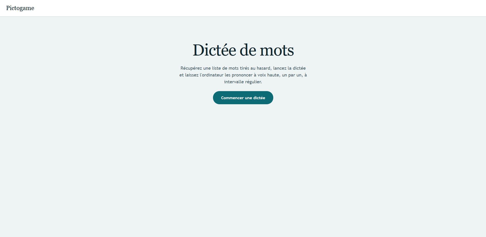
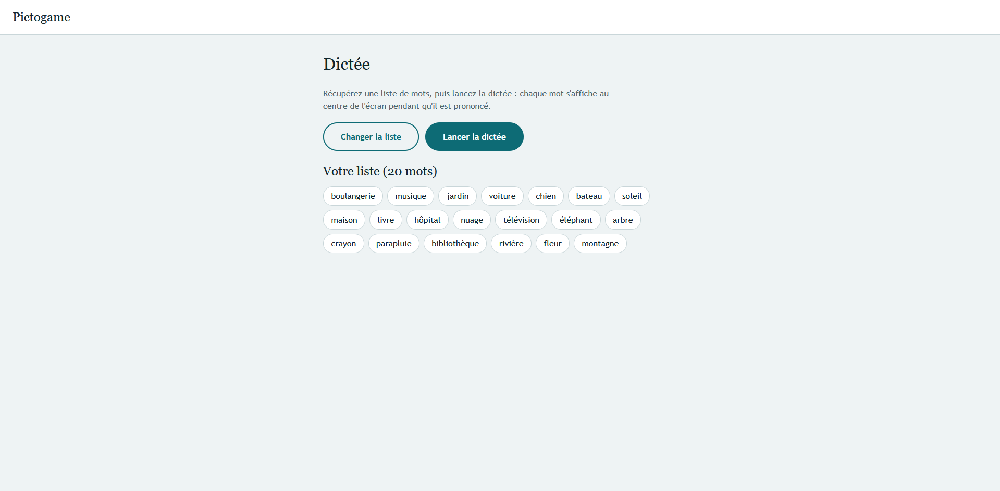
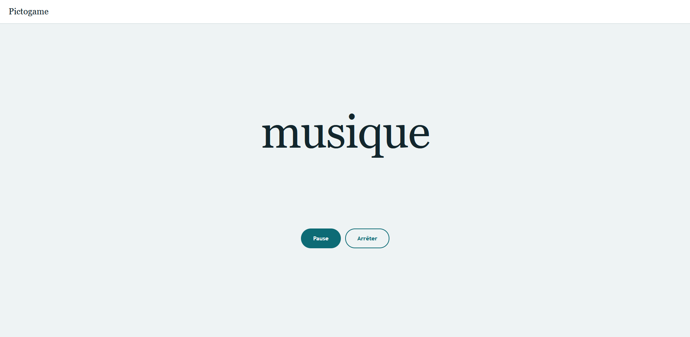

# Pictogame

Pictogame is a companion app for the Pictorush board game. It removes the need for a player to act as playmaker during a round. The current version retrieves a random list of words and reads them aloud as a paced dictation, while showing the active word on screen.

## Table of contents

- [Stack](#stack)
- [Run the app locally](#run-the-app-locally)
- [Current result](#current-result)
- [Code structure](#code-structure)
- [TODO](#todo)

## Stack

- Frontend: React 19, TypeScript, React Router, and Vite
- Backend: Java 25, Spring Boot 4.1.2, Spring Data JPA, and Flyway
- Database: MySQL 8.4

## Run the app locally

Prerequisites: Docker with Compose, Java 25, Maven, Node.js 24, and npm.

1. From the project root, start the database:

   ```sh
   docker compose up -d db
   ```

2. In a terminal, start the backend:

   ```sh
   cd backend
   mvn spring-boot:run
   ```

3. In another terminal, install frontend dependencies and start Vite:

   ```sh
   cd frontend
   npm install
   npm run dev
   ```

4. Open <http://localhost:5173>. Vite forwards `/api` requests to the backend at `http://localhost:8080`. On startup, Flyway creates the word table and inserts the initial word list.

Stop the database from the project root with `docker compose down`. The database volume is retained, so its data remains for the next run.

## Current result

### Home page



### Word list



### Dictation



## Code structure

```text
pictogame/
├── docker-compose.yml
├── backend/
│   ├── src/main/java/chloe/pictogame/
|   |   ├── dto/           # API response types
│   |   ├── models/        # JPA entities
│   |   ├── repository/    # Database queries
│   |   ├── endpoint/      # REST API routes
│   |   ├── common/
│   |   ├── config/
│   |   ├── service/       # Business logic
│   |   ├── exception/     # API error handling
│   |   └── MyApplication.java
|   └── src/main/resources/
|        └── db/migration/ # Flyway schemas
└── frontend/
    └── src/
        ├── App.tsx        # Application routes
        ├── services/
        │   └── api.ts     # HTTP requests to the backend
        ├── pages/
        ├── assets/       
        │   └── styles/    # Global styles
        ├── hooks/
        └── components/
```

The backend exposes `GET /api/words?count=N` (default 20; valid range 1-50). The frontend uses the browser's French speech synthesis and requires browser support for that feature.

## TODO

- Add automated tests for the backend and frontend.
- Dockerize the backend and frontend as well as the database.
- Add game features such as themes, word management, and score tracking.